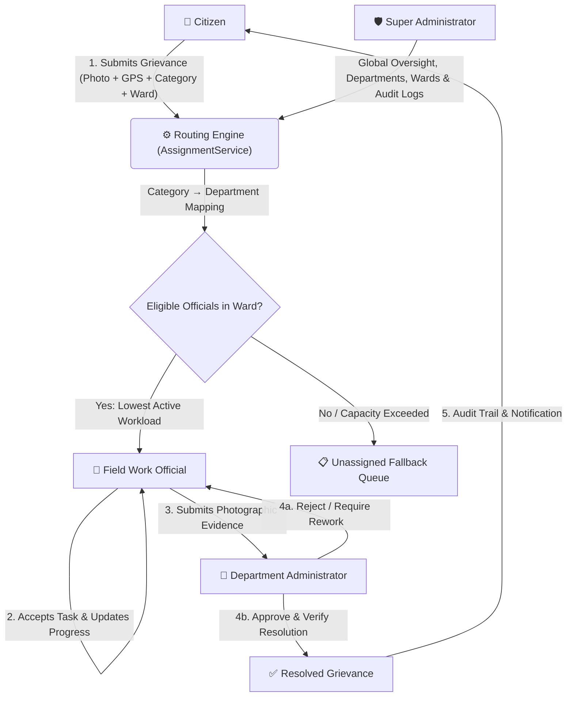

# CivicFix Pro — Smart City Grievance Management System

[](https://civicfix-pro.onrender.com)

[](https://github.com/RamVinayak6046/smart-city-grievance-system/actions)
[](https://www.php.net)
[](https://www.mysql.com)
[](https://www.docker.com)
[](https://getbootstrap.com)
[](REQUIREMENTS_TEST_REPORT.md)
[](LICENSE)

[](https://render.com/deploy?repo=https://github.com/RamVinayak6046/smart-city-grievance-system)
&nbsp;&nbsp;
[](https://railway.app/template/new?template=https://github.com/RamVinayak6046/smart-city-grievance-system)

> **CivicFix Pro** is an automated civic grievance management and municipal workforce platform. It replaces sluggish manual dispatch systems with **deterministic routing, workload balancing, role-isolated portals, and photographic proof-of-work verification**.

---

## 🏛️ System Architecture & Complaint Lifecycle

CivicFix Pro enforces strict separation of concerns across four municipal roles:



---

## ✨ Key Features & Portals

### 1. 👤 Citizen Portal
- **Complaint Submission:** Intuitive grievance filing with title, category, municipal ward, street address, and multi-photo upload.
- **Real-Time Tracking:** Dynamic status timeline (`pending` $\to$ `assigned` $\to$ `in_progress` $\to$ `under_review` $\to$ `resolved`).
- **Data Privacy:** Cross-citizen isolation prevents users from accessing other citizens' sensitive complaints.
- **Notifications & History:** View past grievances, review official comments, and receive live progress alerts.

### 2. 👷 Field Work Official Portal
- **Task Dashboard:** View active work orders, priority tags (`Low`, `Medium`, `High`, `Critical`), and SLA deadlines.
- **Workload Management:** Dynamic assignment queue automatically calibrated to prevent field staff overload.
- **Evidence-Based Completion:** Officials cannot arbitrarily mark tickets "Closed"; they must upload completion notes and photographic proof for departmental verification.

### 3. 🏢 Department Administrator Portal
- **Department Oversight:** Real-time visibility into ward assignments, technician availability, and pending queues.
- **Completion Verification:** Scrutinize before-and-after photos submitted by officials before officially closing grievances.
- **Rework & Reassignments:** Return unsatisfactory work back to field officials with mandatory rework instructions.

### 4. 🛡️ Super Administrator Governance Portal
- **Municipal Management:** Configure municipal departments, grievance categories, service wards, and SLA thresholds.
- **Account Governance:** Provision and audit citizen profiles, department administrators, and work staff.
- **System Audit Trail:** Immutable event logs tracking logins, state transitions, reassignments, and administrative actions.

---

## ⚡ Quickstart & Deployment

### Option 1: Docker / Docker Compose (Recommended)

Run the entire system in one command (no local PHP or MySQL installation needed):

```bash
docker compose up -d
```

Open your browser at **`http://localhost:8000`**.  
The pre-seeded SQLite database and upload storage are mapped automatically.

---

### Option 2: PHP Built-in Server

If you have PHP 8.2+ installed:

```bash
# Clone the repository
git clone https://github.com/RamVinayak6046/smart-city-grievance-system.git
cd smart-city-grievance-system

# Start server
php -S localhost:8000
```

Open **`http://localhost:8000`** in your browser.

---

### Option 3: XAMPP / Apache + MySQL

1. Copy or clone this folder into `C:\xampp\htdocs\civicfix`
2. Start **Apache** and **MySQL** in the XAMPP Control Panel.
3. Import the database schema and seed data into MySQL via phpMyAdmin or CLI:
   ```bash
   mysql -u root -p < database/schema.sql
   mysql -u root -p < database/seed.sql
   ```
4. Update `config/database.php` (set `DB_DRIVER` to `'mysql'`).
5. Access the app at **`http://localhost/civicfix/`**.

---

## 🔑 Demo Seed Accounts

The pre-seeded development database includes ready-to-test accounts for every role:

| Role | Department / Scope | Email | Password |
|---|---|---|---|
| **Super Admin** | Municipal Governance | `admin@civicfix.local` | `Admin@123` |
| **Dept Admin** | Roads Department | `ravi.roads@civicfix.local` | `Admin@123` |
| **Dept Admin** | Sanitation Department | `priya.sanitation@civicfix.local` | `Admin@123` |
| **Dept Admin** | Water Supply | `arjun.water@civicfix.local` | `Admin@123` |
| **Dept Admin** | Electrical & Lighting | `meera.electric@civicfix.local` | `Admin@123` |
| **Work Official** | Roads Department | `suresh.roads@civicfix.local` | `Admin@123` |
| **Work Official** | Sanitation Department | `manoj.sanit@civicfix.local` | `Admin@123` |
| **Work Official** | Electrical Department | `ramesh.electric@civicfix.local` | `Admin@123` |
| **Citizen** | Public Citizen | *Register a new account via the Citizen Portal* |

---

## 🧪 Testing & Verification

CivicFix Pro includes a complete End-to-End automated testing suite verifying all 4 portals, HTTP request cycles, database transactions, role switching, and security guards:

```bash
php tests/assignment_test.php
php tests/e2e_requirement_suite.php
```

**Test Results:**  
See [REQUIREMENTS_TEST_REPORT.md](REQUIREMENTS_TEST_REPORT.md) for full audit logs and evidence (**36 / 36 Requirements Passed, 100% Compliance**).

---

## 🔒 Security Architecture

- **100% Prepared PDO Statements:** Universal parameter binding eliminates SQL injection vectors.
- **Role-Based Access Control (RBAC):** Strict role guards terminate unauthorized portal traversal with HTTP 403.
- **CSRF Protection & Secure Sessions:** Session fixation prevention, `HttpOnly` and `SameSite=Lax` cookies.
- **File Validation:** Server-side MIME-type inspection and randomized hashes prevent malicious file uploads.
- **ACID Transactions:** Full rollback guarantees on assignment and status workflows.

---

## 📄 License

This project is open-source under the [MIT License](LICENSE).
